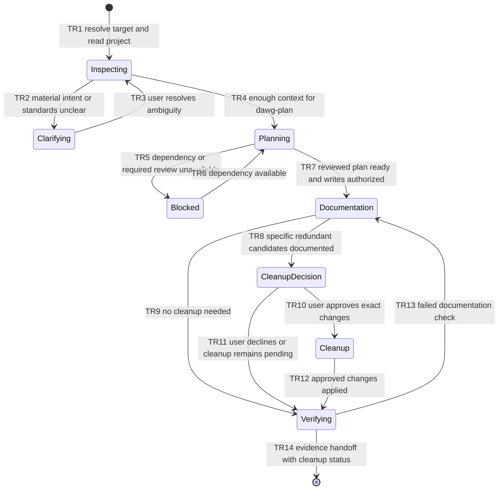
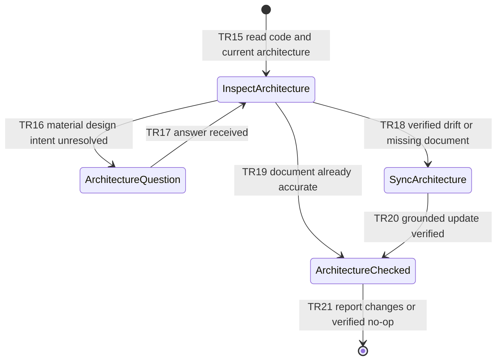

# FEATURE: Dawg repository initialization and architecture maintenance

Status: VERIFIED
Project root: /home/chy/Documents/ChatGPT/skill-related/pdawgy-skills
Plan revision: 2 — 2026-11-12

## Intent and scope

Create two skills in the existing skills-only plugin. The user confirmed the
maintenance skill is named `dawg-architecture-maintain`.

`dawg-init` initializes an existing repository or ordinary directory for coding
agents. It investigates the actual project, runs the bundled `dawg-plan`, asks
about material uncertainties, and creates or updates coding instructions and an
architecture document. `AGENTS.md` is the canonical coding guide; if `CLAUDE.md`
is absent, create a small file instructing Claude to read and follow `AGENTS.md`.
Existing unique instructions and nested scope remain intact. Conflicts require
clarification; do not silently replace the project's standards with guessed ones.

Dawg standards: use the simplest sufficient code; avoid new explanatory code
comments; preserve required license notices, tool directives, and functional
annotations. Do not mass-delete existing comments. Put design descriptions in
`ARCHITECTURE.md`, not `AGENTS.md`. Keep agent guidance limited to how to develop,
verify, and maintain this repository. Existing workflow commands must be grounded
in source, configuration, or CI; missing commands are reported rather than invented.

Cleanup is part of initialization but has its own approval boundary: identify
concrete candidates and evidence, show exact files/edits and expected impact,
ask the user to approve that bounded list, then apply only approved items. Denial
or no answer leaves cleanup pending while independent documentation work proceeds.
An initialization request alone is not approval to remove legacy code or files.

`dawg-architecture-maintain` inspects code and relevant changes, creates or updates
the architecture document to match implemented reality, and preserves design
rationale that remains relevant. Generated `AGENTS.md` requires this maintenance
as part of changes that affect architecture; no unattended background watcher is
promised. Routine architecture sync is a focused documentation task, not a new
planning/review cycle. A newly proposed feature or refactor routes to `dawg-plan`
without claiming the proposed architecture is implemented.

This task creates the skills and packaging documentation. It does not run
`dawg-init` against this plugin repository or clean up its existing artifacts.

## Acceptance criteria

| ID | Observable success condition | Verification |
| --- | --- | --- |
| AC1 | Both skills have valid frontmatter/UI metadata and resolve their packaged resources and sibling dependencies | V1 |
| AC2 | Init investigates first and runs dawg-plan with mandatory exact dual reviews before target documentation changes | V2 |
| AC3 | Existing instructions, dirty files, and nested scope are preserved; concrete cleanup requires user approval before mutation | V2 |
| AC4 | AGENTS contains coding standards/commands, missing CLAUDE delegates to it, ARCHITECTURE holds verified design; comments policy avoids blanket deletion | V2 |
| AC5 | Architecture maintenance handles no Git, no existing doc, no-change runs, drift, and changed boundaries without inventing design or triggering recursive initialization | V2 |
| AC6 | Plugin README lists all skills and manifest version identifies this addition | V1 |

## State machines

| Transitions | Verification |
| --- | --- |
| TR1–TR14 | V2 init walkthrough and instruction review |
| TR15–TR21 | V2 architecture walkthrough and instruction review |

Invariants (V2): no deletion without bounded approval; no implemented claims for
future design; no guessed project commands; no self-recursive skill invocation;
no READY init plan without the dawg-plan reviewers; no changes outside the chosen
project; architecture guidance remains separate from coding instructions.

## Small implementation tasks

### T1: Author dawg-init and reusable document starting points

- Deliverable: `skills/dawg-init/SKILL.md`, UI metadata, and templates for
  `AGENTS.md`, `CLAUDE.md`, and `ARCHITECTURE.md`.
- Dependencies: bundled dawg-plan remains unchanged.
- Covers: AC1–AC4; TR1–TR14 and relevant invariants.
- Verification: V1 validates packaging; V2 reviews design and simulates mature
  and empty project scenarios with concrete proposed outputs.
- Expected: focused repo-specific documents, working plan handoff, preserved
  existing content, cleanup pending without explicit approval.
- Evidence: validation.log; both design-review records; evaluation artifacts.

### T2: Author dawg-architecture-maintain

- Deliverable: `skills/dawg-architecture-maintain/SKILL.md` and UI metadata.
- Dependencies: shared filename/maintenance contract from T1; no circular calls.
- Covers: AC1, AC4, AC5; TR15–TR21 and relevant invariants.
- Verification: V1 validates metadata; V2 evaluates a stale architecture document
  and a no-Git/no-document case, then a no-op repeat.
- Expected: source-grounded architecture with preserved useful rationale and no
  invented background automation or source rewrites.
- Evidence: validation.log; evaluation artifacts and reviewer reports.

### T3: Integrate and verify the plugin

- Deliverable: README descriptions and examples; plugin version 0.2.0.
- Dependencies: T1, T2.
- Covers: AC1, AC6; package integration.
- Verification: V1 invokes standard validators, parses metadata, resolves
  resource links, and checks new-file whitespace. V2 confirms behavior.
- Expected: all three skills discoverable under the existing skills path.
- Evidence: validation.log with commands and file hashes.

## Independent design review

| Reviewer | Model / effort | Revision | Outcome | Record |
| --- | --- | --- | --- | --- |
| Astra | gpt-6-astra / high | 2 | P2 resolved; no material findings; plan ready | verifications/design-review-astra.md |
| Sol | gpt-6.1-sol / high | 2 | P2 resolved; no material findings; plan ready | verifications/design-review-sol.md |

Both revision 1 reviews found no material workflow-design issues but identified
missing reproducible verification inputs/commands. Revision 2 adds a saved
packaging validator, raw fixture JSON, deterministic fixture builder, shared
walkthrough request, and case-specific source-grounded inspection observations.
Both reviewers reassessed the remedy and confirmed the plan ready. After authoring,
both independently reviewed the actual skills and completed the bounded walkthrough
with no material findings. V1 and V2 pass; see their records and archived reports.

Readiness requires both reviews complete, material findings resolved, and no open
material questions. Skills are created only after this plan is ready.

## Verification and handoff

Checklist: [verifications/verification.md](verifications/verification.md).
Implementation is authorized by the user's request to create these skills.
Completion requires V1 and V2 to pass with evidence; design approval is not proof
of future agent compliance. Screenshots are unnecessary for these text workflows.

Completion: all three skill packages validate; both reviewed new skills preserve
the approved contracts. Each reviewer preserved all 14 original non-architecture
fixture files, corrected mature architecture and created an honest empty baseline,
and verified byte-identical no-op maintenance. Init remained proposed with its
nested review gate explicitly unexecuted. The already-installed local plugin was
refreshed to 0.2.0 and verified enabled with all packaged files matching source;
see `verifications/local-install.json`.
