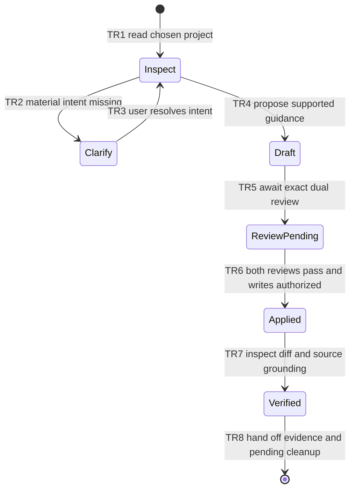

# FEATURE: Initialize mature guidance — proposed only

Status: DRAFT
Project root: /tmp/dawg-init-sol-eval/mature
Plan revision: evaluation proposal 1
Normal final location if authorized and reviewed:
`.dawgy/dwag-plan/FEATURE_AGENT_GUIDANCE/PLAN.md` in the chosen target project.
This evaluation stores drafts outside the target and defers all nested reviews.

## Intended behavior

Preserve existing valid instructions and local work; propose canonical coding
AGENTS, compatible CLAUDE delegation, and factual separate ARCHITECTURE. No
cleanup is authorized. See QUESTIONS_AND_CLEANUP.md for uncertainties and scope.

## Acceptance and bounded task

- AC1: useful original/scoped rules and user files survive; V1.
- AC2: proposed AGENTS coding guidance stays separate from source-grounded
  architecture; established commands only; V1.
- AC3: CLAUDE content is preserved and delegates compatibly; V1.
- AC4: no cleanup occurs without exact approval; V1.
- T1: after readiness and authorization, merge the proposed guidance files with
  target content, respecting nested scope; verify by the concrete V1 inspection.

TR1–TR5 were investigated or remain pending in this evaluation; TR6–TR8 are
proposed production behavior, not claimed executed. V1 covers all transitions by
read-only design/inspection; applied initialization is explicitly untested.
Invariant: no target guidance writes before readiness; no cleanup without bounded
approval; no invented project facts; no unsupported VERIFIED claim.

## Required independent reviews

- gpt-6-astra / high: PENDING, not invoked in this bounded walkthrough.
- gpt-6.1-sol / high: PENDING, not invoked in this bounded walkthrough.

Readiness is not established. Planning artifacts do not prove implementation.
Checklist: [verifications/verification.md](verifications/verification.md).
