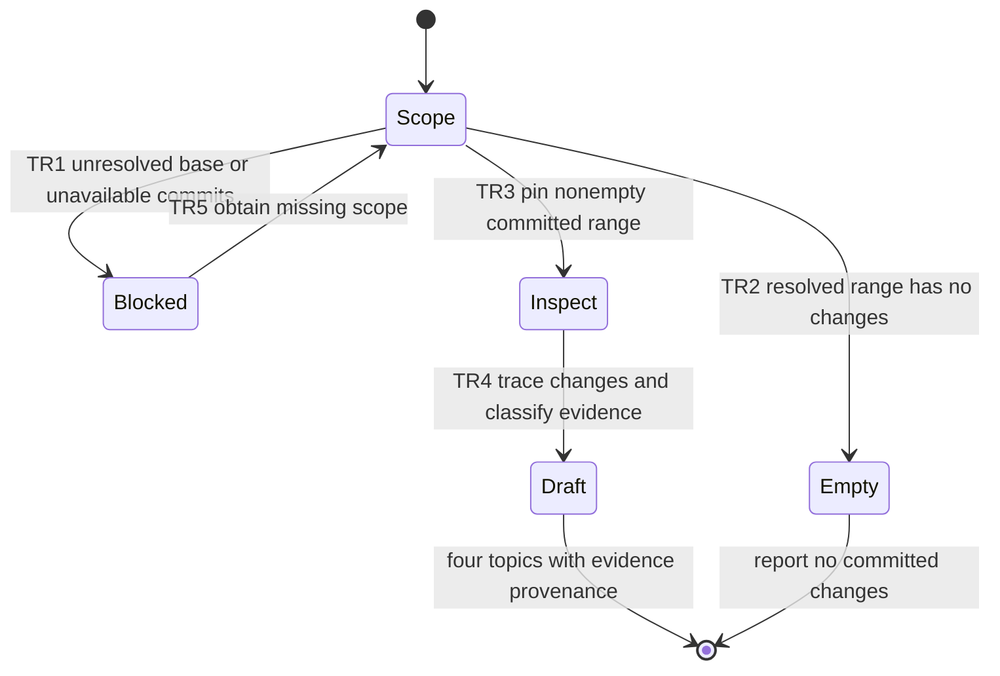

# Feature: Dawg MR

Status: IMPLEMENTATION VERIFIED. Parent and both exact reviewers approved revision 1; all implementation checks pass. Delivery PENDING in this pre-delivery snapshot.

## Intent and scope

Add `dawg-mr`: quickly inspect committed changes and draft an MR message with
Problem, Fix, Blast radius, and Verified/tested. Draft in chat; do not publish an
MR, change Git state, run a planning cycle, or launch tests merely to summarize.
Read applicable instructions, honor explicit base/head or commits, otherwise use
an established MR target or unambiguous integration base. Pin identities; use a
merge-base comparison for branch changes. Tracking the same feature branch is not
an integration base. Resolve materially ambiguous scope before writing a message.
Exclude index/worktree changes, and inspect pinned committed blobs even when dirty.
Trace changed behavior and relevant direct consumers; prefer source over commit
subjects. Evidence must identify commands, results, revision/scope and provenance.
Current failures remain failures; absent/stale evidence is unverified, not passed.
A dirty-checkout run is not proof about clean committed HEAD. Do not run broad tests.
Use repository MR templates where present, preserving the four requested topics.

## Git and authorization

- Source root/selected directory: `/home/chy/Documents/ChatGPT/skill-related/pdawgy-skills` (relative scope `.`).
- Base: `be80a23f26dcc02e360050f8ed1e214ad8567ff8`, committed 0.5.0 policy update;
  origin/main is still 0.4.0. This is a dependent feature, preserving that update.
- Worktree and mapped project: `/home/chy/Documents/ChatGPT/skill-related/pdawgy-skills-worktrees/dawg-mr`.
- Branch: `codex/feature/dawg-mr`; remote `origin`, same branch destination.
- User authorized skill implementation; repository workflow authorizes verified
  Conventional Commit and normal task-branch push. No PR creation/merge requested.
- Preflight: both source and base worktrees clean, no staged content; preserve them.

## Acceptance criteria

- AC1: Discoverable `dawg-mr` with consistent frontmatter/UI and concise instructions.
- AC2: Draft reflects a resolved, pinned committed range; excludes dirty/staged/
  untracked content; unknown/empty scope is surfaced honestly.
- AC3: Message covers the problem, fix, source-grounded blast radius and evidence.
- AC4: Passing claims require applicable current evidence; stale, absent, failed,
  or uncommitted-only results are labeled with provenance and limitations.
- AC5: Quick read-only drafting: no automatic mutation, publishing, tests, reviews,
  worktree or TLA+ ceremony during runtime invocation.
- AC6: Version 0.6.0 and repository documentation accurately include four skills.

## State machine

| Transition | Requirement | Formal mapping / practical check |
| --- | --- | --- |
| TR1 | AC2 | Resolve -> blocked; ScopeSound; V3 |
| TR2 | AC2 | Resolve -> empty; ScopeSound; V3 |
| TR3 | AC2 | Resolve -> inspect; ScopeSound; V3 |
| TR4 | AC3/4/5 | Draft, EvidenceSound, UnknownExplicit, FourTopics; V3 |
| TR5 | AC2 | NewRequest; V3 ambiguity inspection |

## Formal scope

`MrDraft.tla` models the input/output relation for known/unknown base, nonempty/
empty committed changes, four evidence classes (current pass, stale pass, failure,
absent), and clean/dirty checkout. All combinations are explored. Required
invariants: TypeOK, ScopeSound, EvidenceSound, UnknownExplicit, FourTopics.
`EvidenceFault.cfg` deliberately mislabels evidence to demonstrate detection;
`DraftWitness.cfg` deliberately asserts no draft to show a reachable output.
The default model enables deadlock checking; terminal outputs stutter and permit
another request, including resolution of an initially unknown base. No fairness,
state constraints, reductions, or liveness claims. Finite safety model abstracts
Git diff interpretation, evidence applicability, prose quality and tool behavior;
it does not prove future agents truthful or real Git read-only. V3 covers these.
Dirty checkout cannot upgrade the evidence class; a current-pass input means
inspected evidence already tied to the clean committed revision, not a dirty run.

## Small tasks

| Task | Deliverable | Acceptance / verification |
| --- | --- | --- |
| T1 | Reviewed plan and concrete formal input/output model | AC2-5, V1 parent and both exact reviewer runs |
| T2 | New SKILL.md and agents/openai.yaml | AC1-5, V2 validator; V3 isolated forward evaluation |
| T3 | Manifest 0.6.0, README and architecture | AC6, V2 JSON/YAML/links and source inspection |
| T4 | Verify source, inspect entire index, commit and push task branch | all ACs, V4 full staged scope and committed tree; remote receipt in chat |

## Verification and review

See [verifications/verification.md](verifications/verification.md) and
[verifications/failures.md](verifications/failures.md). Preserve every actual
non-green attempt; diagnose, repair and rerun affected checks until green.
Both `gpt-6-astra`/high and `gpt-6.1-sol`/high must independently execute identical
final formal inputs and approve semantics before implementation. Each then tests
actual skill against isolated Git fixtures, with raw artifacts in its own directory.
No dependency/framework added to the plugin. No screenshot check applies.

## Review dispositions

Parent-02, astra-01 and sol-01 each completed required exploration (72 distinct
states, queue 0) and both exact probes. Both semantic reviews approved revision 1
with no material findings. See verifications/design-review-astra.md,
verifications/design-review-sol.md and parent-formal-review.md. Final input hashes
match across all receipts. F1 corrected before independent runs; old attempt
preserved. No behavior/model changes since approval. Material changes invalidate
all three formal receipts.

## Delivery

Implementation VERIFIED; delivery PENDING. Both authored-source reviews and actual
isolated forward evaluations passed with no material findings. Local plugin0.6.0
is refreshed and byte-verified (18 files), persistent source unchanged. All three
observed authoring/evaluation issues are resolved with original attempts retained. Tracked ledger is a pre-delivery snapshot;
final commit/remote OIDs go in chat to avoid a self-referential commit receipt.
