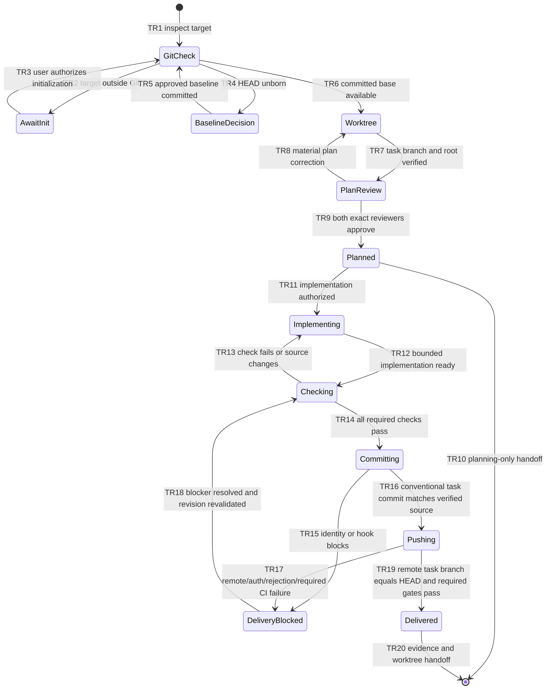

# FEATURE: Verified Git worktree delivery for Dawg Plan

Status: VERIFIED
Project root: /home/chy/Documents/ChatGPT/skill-related/pdawgy-skills-worktrees/dawg-plan-git-workflow
Plan revision: 2 — 2026-11-12
Source checkout: /home/chy/Documents/ChatGPT/skill-related/pdawgy-skills
Base commit: 4947bf3ad1f85adf8abc9ed327d6c9a50fa7c282
Task branch: codex/feature/dawg-plan-git-workflow
Remote: origin — https://github.com/pdawgy-sg/pdawgy-skills.git
Implementation authorization: user requested this feature, automatic Conventional Commit and branch push.
Delivery: PENDING

## Intent and constraints

Update dawg-plan so every feature/fix uses a dedicated linked Git worktree and
branch. Detect Git using Git itself (linked worktrees have a .git file). Outside
Git, ask the user to initialize and wait before writing plans or implementation;
never silently initialize. Handle an unborn repository with a separately approved
baseline snapshot/empty baseline. Preserve unrelated staged, dirty and untracked
work; do not blanket stash, copy or commit it. Keep the full existing intent,
diagram, small-task, evidence and exact dual-review requirements.

After authorized implementation, run meaningful proportionate checks and require
all required checks to pass. Stage only task paths and inspect the staged diff,
commit with a Conventional Commit (feat/fix, optional meaningful scope), then push
only the current task branch normally with upstream tracking. Inspect the entire
existing index and working diff before staging. If a resumed worktree includes
unrelated staged files or mixed same-file hunks, block delivery until ownership
is resolved or the user authorizes deliberate isolation; do not unstage/reset
their work automatically. Stage by whole path only when every changed hunk is
task-owned. Inspect the entire proposed and created commit delta, not only task
file hashes. Verify committed implementation matches tested source and remote
branch OID equals local HEAD.
Handle missing identity, unknown remote, auth, hooks, rejection or CI requirements
honestly; no force push, hook skipping, invented identity or implicit merge into
main. Commit/push fails stop delivery, while verified implementation remains
separately recorded. Respect planning-only and explicit user delivery limits.

Default branch names are codex/feature/<slug> and codex/fix/<slug>. Reuse a matching
task worktree when resuming; inspect worktree/branch identity instead of nesting
another. Choose the user-specified or unambiguous configured remote and push to
the same task branch name, never its base branch. Keep artifacts in the task
mapped target's .dawgy/dwag-plan/<FIX|FEATURE>_<PLAN_NAME>/ path. Record the original
repository root, selected target-relative path, worktree repository root, and
mapped project directory. Tell callers both roots; dawg-init must map an original
subdirectory request into the same relative location in the worktree for all its
guidance/architecture edits, preserving ancestor/nested instruction scope. Git
operations use the worktree repository root; project commands/artifacts use the
mapped target. Never expand a subdirectory init to the whole repository.

Update PLAN and verification templates with Git context and separate delivery
status. Put detailed Git handling in a required linked references/git-workflow.md
rather than inflate every skill section. Align dawg-init, its AGENTS asset, root
AGENTS, README and ARCHITECTURE with the new contract; bump plugin to 0.3.0.
Routine architecture-only sync remains a focused documentation workflow. Preserve
all historical plans/evidence. No cleanup or main-branch merge is part of this task.

The user approved the exact 139-file baseline commit and supplied repository-local
Git author identity and origin URL. Baseline is committed; this worktree already
exists. The remote is reachable and currently advertises no branch heads. GitHub
write authorization is checked by the final actual push, not inferred from read
access.

## Acceptance criteria

| ID | Observable outcome | Check |
| --- | --- | --- |
| AC1 | Non-Git detection asks/waits; unborn/dirty state handled without losing unrelated work; task worktree/branch required | V1, V2 |
| AC2 | Plans/evidence and callers consistently use linked worktree root; resumes reuse correct branch | V1, V2 |
| AC3 | Authorized implementation is verified, task-only staged, conventionally committed and normally pushed to task branch with OID confirmation | V1, V2, V3 |
| AC4 | Plan-only requests and failed/blocked checks never auto-deliver; delivery blockers remain explicit | V1, V2 |
| AC5 | Templates/UI/docs reflect policy and dependencies, validators pass; old evidence unchanged | V1, V3 |

## State machine

All transitions/invariants are inspected by V1/V2. V2 exercises actual Git worktree,
commit, push and remote OID behavior in local disposable fixtures. V3 exercises
this feature's real worktree and delivery. Unavailable-model, denied-init and
credential/error branches are inspected without inventing approvals or failures.

## Small implementation tasks

### T1: Change core planning and Git delivery contract

Deliver dawg-plan/SKILL.md, references/git-workflow.md, two artifact templates and
UI metadata. Keep user-intent and review rules intact. Verify V1 structural/resource
checks and V2 independent scenario evaluations. Evidence: validation.log, reviewer
records and evaluation reports. Covers AC1–AC4; TR1–TR20.

### T2: Align callers and documentation

Update dawg-init Git prerequisite/worktree handoff and delivery delegation, its
AGENTS template, root coding guide, README, architecture and plugin version.
No old plan/evidence edits. Verify V1 links/validators and V2 design consistency.
Covers AC2, AC4, AC5 and the worktree handoff invariant. Evidence as in T1.

### T3: Verify and deliver this update

Run final checks in this worktree, inspect exact staged task files, create
`feat(dawg-plan): require verified worktree delivery`, push the task branch to
origin, and confirm remote OID equals committed HEAD. Save implementation evidence
before committing; report final commit/remote receipt in chat to avoid a recursive
commit of a receipt containing its own commit ID. No source changes after checks
without revalidation. Covers AC3/AC5; TR12–TR20. Evidence: V3 Git outputs and chat.

## Independent reviews

| Reviewer | Model / effort | Revision | Outcome | Record |
| --- | --- | --- | --- | --- |
| Astra | gpt-6-astra / high | 2 and authored source | Both remediations and actual local Git walkthrough pass; no material findings | verifications/design-review-astra.md |
| Sol | gpt-6.1-sol / high | 2 and authored source | Both remediations and actual local Git walkthrough pass; no material findings | verifications/design-review-sol.md |

Revision 2 addresses both findings: preserve selected target-relative scope across
worktree handoff, and block delivery of unresolved unrelated index/mixed-hunk
changes while inspecting whole commit deltas. V2 includes both focused probes.

Readiness requires both reviewers and all material findings resolved. The skill
feature is implemented only after plan readiness. No screenshot is needed for
these text/Git workflows. Checklist: [verifications/verification.md](verifications/verification.md).

## Pre-delivery verification snapshot

V1 and V2 pass. Both actual-source reviews found no material issues; independent
local Git worktree fixtures verified behavior, task-only Conventional Commits,
normal pushes and matching remote OIDs. Both preserved dirty source work, blocked
mixed/index resume without mutation, and verified selected-subdirectory mapping.
Implementation source fingerprints and logs are saved. Earlier tracked evidence
is untouched. Astra preserved and corrected a harness-only diff-prefix comparison
failure; no implementation change was needed.

Delivery is pending the actual inspected commit/push. The final commit hash,
normal origin task-branch push outcome, remote OID equality and clean-worktree
receipt will be reported in chat rather than modifying this commit to contain
its own future ID/push result. This file is intentionally a pre-delivery snapshot.
