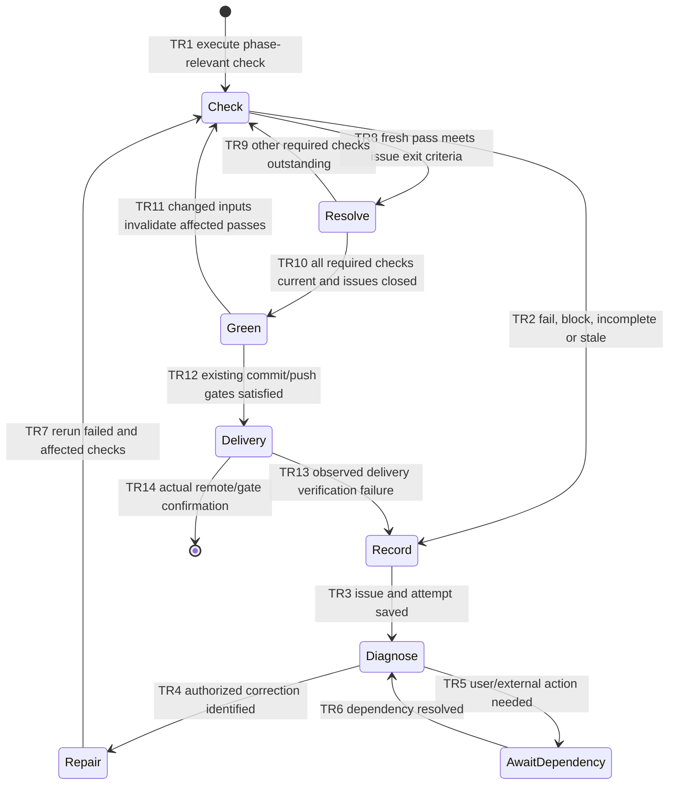

# FEATURE: Persistent failures and repair until green

Status: VERIFIED
Revision: 1 — 2026-11-12
Source: /home/chy/Documents/ChatGPT/skill-related/pdawgy-skills
Selected relative scope: .
Worktree/mapped project: /home/chy/Documents/ChatGPT/skill-related/pdawgy-skills-worktrees/dawg-plan-green-verification
Base: b8e2ee8d67ee7c707aae7dd7ff09091367640ca2
Task branch: codex/feature/dawg-plan-green-verification
Remote/destination: origin / same task branch
Implementation authorized: user requests recording every non-green observation and working until green.
Delivery: PENDING; final receipt in chat.

## Intended behavior

Strengthen dawg-plan's implementation/verification behavior: a failed or blocked
check is work to diagnose and repair, not a reason to finish at a report. Persist
a stable issue record in verifications/failures.md and preserve individual raw
attempts, reproduction, expected/actual result, tested input identity, cause,
action, current status, next step and successful rerun evidence. Link it to the
verification checklist and tasks. Reopen a recurring issue; never erase failure
history or close it merely because a patch was written.

After an observed non-green result, record it promptly, investigate the cause,
make the smallest justified in-scope correction, rerun the failed check plus
checks affected by the change, and repeat until the current phase's required
checks pass with no unresolved issues. Avoid blind identical retries, skipping
or weakening checks, hiding flakes, overwriting logs, or waiving a red check as
preexisting/unrelated. Planned checks remain unchecked until executed; merely
being scheduled for a later phase is not an invented defect. At the applicable
verification gate, unrun/stale/incomplete required checks are still non-green.

Green is phase/revision specific. Plan readiness requires the formal checks and
reviews; a plan-only request does not require running unimplemented feature tests.
Implementation completion requires its concrete checks and affected regressions.
Commit/push/CI stages retain their existing gates and any observed errors get
recorded in the same ledger. Material formal changes trigger all three TLA reruns.
Source changes invalidate affected old passes. Expected negative probes pass only
when their named expected outcome occurs, not when a parser/tool fails.

When progress genuinely requires user intent, credentials, permission or external
state, record the exact blocker and needed action, ask early, and continue useful
independent authorized work. Do not claim completion or delivery while required
issues remain unresolved. Resume repairs after resolution. Do not bypass approval,
alter unrelated scope or spin forever repeating an unchanged failing command.

Implement one required linked reference for this loop, a compact failures.md
asset, and checklist/PLAN fields for issues and current green evidence. Align
main skill, Git/TLA references, dawg-init/coding asset, root guidance/docs/UI and
version0.5.0. Preserve all historical evidence and the prior mandatory worktree,
TLA/dual-review, proportional-test and verified Conventional Commit/push rules.

## Acceptance criteria

| ID | Observable result | Check |
| --- | --- | --- |
| AC1 | Every observed non-green result is durably linked to a stable issue and immutable attempt evidence | V1, V2 |
| AC2 | Agents diagnose, correct, rerun and reopen until all phase-relevant checks are current/green, without check weakening or blind retries | V1, V2 |
| AC3 | Genuine blockers stay explicit/unverified while independent work continues; expected negatives and plan-only phases are handled honestly | V2 |
| AC4 | Completion/commit/push cannot proceed on failed, blocked, incomplete or stale required checks; repaired historical failures remain visible | V1, V2, V3 |
| AC5 | Metadata/templates/callers/docs consistent; validators pass; task-only commit/push remote confirmed | V2, V3 |

## State machine

## TLA+ scope and results

verifications/tla/Recovery.tla models two representative implementation checks
(tests and verification), pending/pass/fail/blocked outcomes, revision0/1, a
current issue set, persistent failure-history membership, per-observation recording
and a corrective-action-before-retry flag. Run reopens observed failures; Repair
abstracts diagnosed remediation; successful reruns resolve their issues; Complete
requires all passes on the current revision and no open issue. Invalidate resets
passes while preserving issue/history. No retry cap is imposed; repeated failures
and remediation form a finite cyclic state graph.

Properties: TypeOK; IssueRecorded; CompletesOnlyGreen; HistoryPreserved (temporal
safety, not a liveness guarantee). Production config enables both recording and
green gates with CHECK_DEADLOCK TRUE. Hold is intentional verified-state waiting.
No unconditional eventual-success claim is possible under permanently failing
external tools or missing user authority; fairness is not fabricated to force it.

| Config | Expected | Purpose |
| --- | --- | --- |
| Recovery.cfg | complete exit0, invariants/action-safety property hold | record/repair/current-green contract |
| MissingRecord.cfg | IssueRecorded trace, nonzero | intentionally omit failure recording |
| RedCompletion.cfg | CompletesOnlyGreen trace, nonzero | intentionally allow completion while red |
| RecoveryWitness.cfg | NoRecoveredCompletion trace, nonzero | actual failure-record/repair/rerun/completion is reachable with preserved history |

EnforceRecord/EnforceGreenGate are false only in labeled sensitivity probes, not
user-facing policy switches. This abstraction checks the recovery protocol, not
real filesystem durability, unlimited log contents, actual code correctness,
full Git behavior, or user/tool truthfulness. Those are covered by source review,
the concrete ledger/fixture checks and retained delivery checks.
AC1/TR2–TR3 -> IssueRecorded/HistoryPreserved; AC2/TR4/TR7–TR10 -> Repair/Run/
Complete plus RecoveryWitness; AC4/TR11 -> Invalidate and CompletesOnlyGreen.
AC3 and delivery-specific transitions are bounded source/fixture inspections.

Primary TLC: 178 distinct states, queue0, exit0; each labeled sensitivity/witness
probe produced its named violation/trace (exit12). Command and all raw logs are
preserved. Parent and both reviewers must independently run matching final inputs.

## Small tasks

### T1: Recovery loop and durable ledger

Deliver main dawg-plan loop/reference, failures.md asset and PLAN/verification
fields. AC1–AC4. Verify V1 model runs and V2 concrete red/green/reopen/blocked
walkthrough; preserve attempts and input identities, without adding a framework.

### T2: Align callers and docs

Update Git/TLA references, dawg-init/coding-guide asset, root AGENTS/README/
ARCHITECTURE/UI and plugin0.5.0. AC3–AC5. Verify V2 standard validators, resource
links, metadata and independent source review. No earlier plan/evidence edits.

### T3: Verify and deliver

After V1/V2 pass, inspect entire task-owned index and commit tree, commit
`feat(dawg-plan): record failures and repair until green`, push same task branch
normally and confirm remote OID. AC4/AC5. V3 actual receipt follows in chat;
committed evidence is an honest pre-delivery snapshot. No implicit merge.

## Independent reviews

| Reviewer | Model/effort | Revision | Result | Record |
| --- | --- | --- | --- | --- |
| Astra | gpt-6-astra/high | 1; final source/fixture | TLC and real recovery passed; approved without material findings | verifications/design-review-astra.md |
| Sol | gpt-6.1-sol/high | 1; final source/fixture | TLC and real recovery passed; approved without material findings | verifications/design-review-sol.md |

Readiness requires current matching parent/Astra/Sol TLC checks and both semantic
approvals. Checklist: [verifications/verification.md](verifications/verification.md).
Actual issue ledger: [verifications/failures.md](verifications/failures.md).

Both reviewers independently executed and audited matching final inputs: 178
production states, empty queue, exit0; all three named sensitivity/witness traces
exit12. Both approved revision1 without material findings. Concrete recovery and
final-source checks now pass: each reviewer observed real assertion exits 1/0/1/0,
recording before repair, stale-pass invalidation/reopening, fresh resolution and
preserved failed logs/assertions. Both retained an honestly blocked separate tool
case while independent inspection continued. Formal inputs match actual receipts;
no redundant model run was needed. V1/V2 source/metadata/link/JSON/whitespace checks
pass. Actual task F1/F2 were recorded and resolved with evidence. F3 metadata
correction also passed its exact metadata/link/fingerprint checks; no actual issue
remains unresolved. Delivery still waits for the real scoped commit/push.
This remains a pre-delivery snapshot; final commit/push receipt will be in chat.
