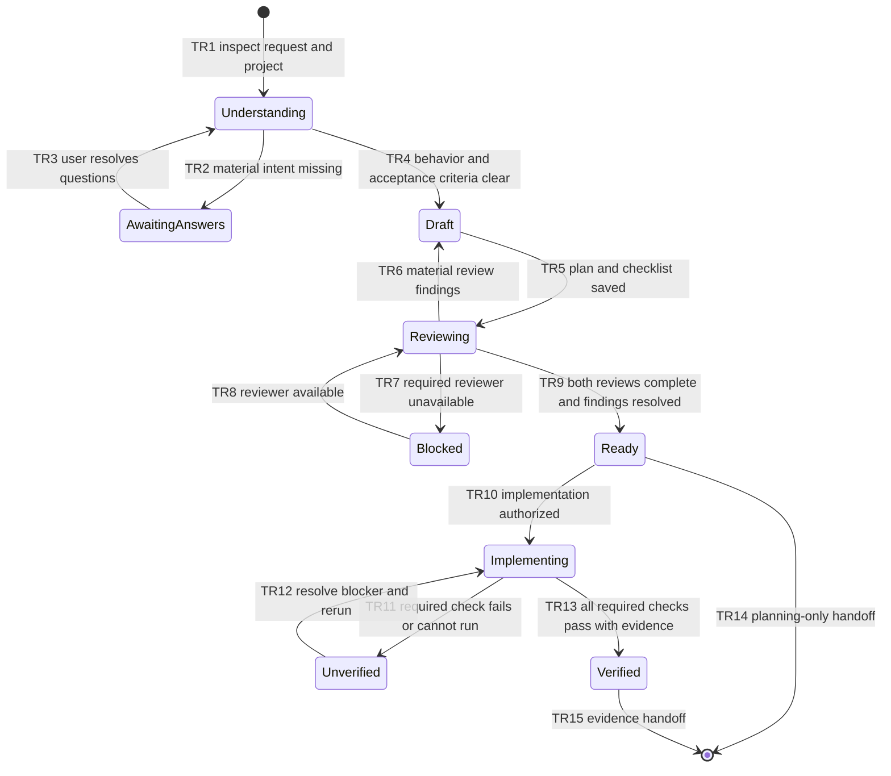

# FEATURE: Dawg Plan skill

Status: VERIFIED
Project root: /home/chy/Documents/ChatGPT/skill-related/pdawgy-skills
Plan revision: 2 — 2026-11-11

## Intent and scope

Build the first bundled skill, `dawg-plan`, to turn feature/fix requests into
understood, diagrammed, independently reviewed plans with reproducible evidence.
The user confirmed that every future plan requires GPT-6 Astra and GPT-6.1 Sol,
both at high effort. Preserve the requested `.dawgy/dwag-plan/` spelling and use
`verifications/` consistently. Creation of this skill is authorized.

The existing plugin already discovers `./skills/`; no marketplace wiring changes
or plugin installation are required. This change adds instructions, two reusable
templates, UI metadata, and a README entry. It adds no test framework or runtime
dependencies to the plugin.

## Acceptance criteria

| ID | Observable success condition | Verification |
| --- | --- | --- |
| AC1 | Skill has valid frontmatter and UI metadata and is discoverable through the plugin's skills path | V1 |
| AC2 | Workflow resolves material intent gaps, diagrams actual behavior, and assigns proportionate evidence to every small task | V2 |
| AC3 | Every plan requires both exact reviewers at high effort; readiness is distinct from verified implementation | V2 |
| AC4 | Artifacts use the requested paths; screenshots are saved and shared, and unexecuted checks cannot be claimed as passed | V2 |

## State machine

This models the planning behavior delivered by the skill. Implementation is
entered only if separately authorized by the user's task.

| Transitions | Behavior covered | Verification |
| --- | --- | --- |
| TR1–TR4 | Repository investigation, focused questions, and acceptance criteria | V2 |
| TR5 | Target-project artifacts and templates | V1, V2 |
| TR6–TR9 | Independent review, remediation, and unavailable-tool handling | V2 |
| TR10–TR15 | Authorization, truthful verification statuses, reruns, evidence handoff | V2 |

Invariants: no unresolved material intent at readiness; no substituted or invented
reviews; no checked verification without observed evidence; no implementation
authorization inferred from a planning-only request. V2 inspects these rules and
exercises plan drafting in an isolated fixture. Live UI capture and unavailable
model conditions are instruction-reviewed rather than end-to-end exercised.

## Implementation tasks

### T1: Package skill instructions and templates

- Deliverable: `plugins/pdawgy-skills/skills/dawg-plan/SKILL.md`,
  `agents/openai.yaml`, `assets/PLAN.md`, and `assets/verification.md`.
- Dependencies: none.
- Covers: AC1–AC4; TR1–TR15.
- Verification: V1 validates structure; V2 independently inspects design and
  forward-tests drafting, without implementing the fixture.
- Evidence: `verifications/validation.log`, both design review records, and
  isolated evaluation artifact copies.

### T2: Integrate documentation and remove the empty-directory marker

- Deliverable: README lists the skill, invocation, reviewer requirements, and
  artifact paths; the old `skills/.gitkeep` marker is removed.
- Dependencies: T1.
- Covers: AC1, AC3, AC4; TR5.
- Verification: V1 inspects plugin discovery and README consistency.
- Evidence: `verifications/validation.log`.

## Independent design reviews

| Reviewer | Model / effort | Revision | Outcome | Record |
| --- | --- | --- | --- | --- |
| Astra | gpt-6-astra / high | Revision 2 | P2 resolved; no material issues remain | verifications/design-review-astra.md |
| Sol | gpt-6.1-sol / high | Revision 2 | P2 resolved; no material issues remain | verifications/design-review-sol.md |

Reviewers receive the same requirements, skill files, and small CLI fixture.
They draft a dry-run feature plan and consider an ambiguous request without
implementing the fixture or recursively invoking additional reviewers. The
evaluation deliberately leaves its own nested reviews pending.

Both reviewers identified the same P2 development-artifact issue in revision 1:
the verification checklist named operations without exact commands or preserved
fixture/review inputs. Revision 2 adds `verifications/validate_packaging.py`, its
exact invocation and prerequisites, `validation-history.md`, and
`verifications/evaluation/` containing the original inputs, review request, and
both generated plan/checklist pairs. Packaging validation now passes. This
remediation changes evidence reproducibility, not the distributed skill design.

## Verification and handoff

Checklist: [verifications/verification.md](verifications/verification.md)

Both reviewers reassessed revision 2 and confirmed the P2 remedy resolved with
no material issues remaining. Both independently reran packaging validation
successfully (exit 0), confirmed the unchanged reviewed skill hash, and checked
the preserved inputs/evaluation outputs. V1 and V2 pass. No fixture implementation,
live screenshot capture, plugin installation, or guarantee of future agent
compliance is claimed.
