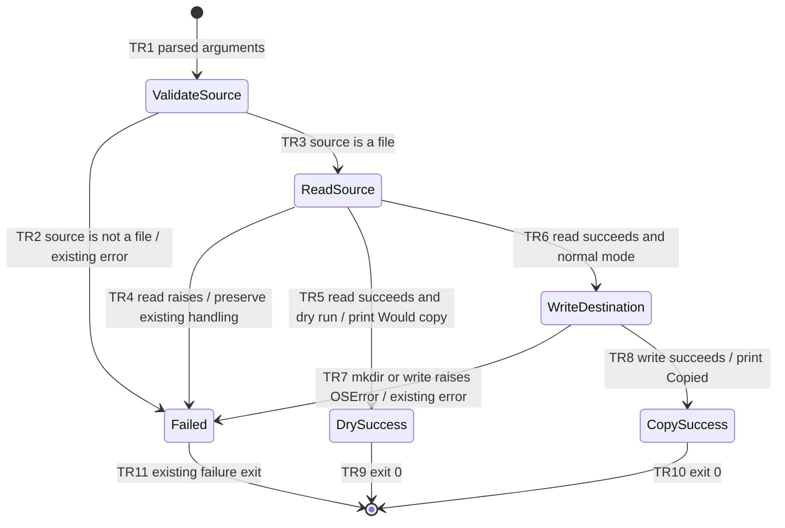

# FEATURE: Copy dry run

Status: BLOCKED
Project root: /tmp/dawg-plan-astra-eval
Plan revision: evaluation draft 1 / 2026-11-11

This isolated evaluation project contains unchanged copies of the supplied request and source. The shared original fixture remains read-only. No fixture implementation is authorized.

## Intent and scope

- User outcome: preview a copy with `--dry-run`, including source validation and reading, without destination mutations.
- Current behavior, inspected in `copy_text.py`: argparse accepts two Path arguments; a non-file source prints `Source must be a file` to stderr and returns 1. The source is read before destination parents are created and the destination is written. An OSError in that block prints its message to stderr and returns 1. Success prints `Copied SOURCE -> DESTINATION` and returns 0. Existing destinations are overwritten.
- Desired behavior: add a boolean `--dry-run` option defaulting to false. After the existing source validation and successful read, a dry run prints exactly `Would copy SOURCE -> DESTINATION` followed by a newline and returns 0 before mkdir or write. Use existing Path formatting for SOURCE and DESTINATION.
- Constraints and exclusions: standard library only; preserve normal output, overwrite behavior, directory creation, and existing errors. Do not check destination writability during dry run. No new overwrite protection, atomic copy, encoding policy, or destination validation is requested. Existing unhandled non-OSError read exceptions remain unhandled.
- Assumptions: a normal argparse boolean flag is a harmless implementation choice; no additional product questions are needed for this explicit request.
- Blockers: the two required design reviews are deliberately pending in this isolated drafting evaluation; the parent instructed this reviewer not to run nested reviews. This plan is not ready for implementation.

## Acceptance criteria

| ID | Observable success condition | Verification IDs |
| --- | --- | --- |
| AC1 | `--dry-run SOURCE DESTINATION` reads a valid source, prints exactly `Would copy SOURCE -> DESTINATION\n`, and returns 0. | V1 |
| AC2 | Dry run creates no destination directories or files and leaves an existing destination unchanged; an unusable destination parent does not prevent successful dry run. | V1 |
| AC3 | Dry run has the same missing-file and read-error behavior as normal mode, without success output or destination writes. | V1 |
| AC4 | Normal mode retains its success output, parent creation, overwrite behavior, and destination error behavior. | V1 |
| AC5 | The change uses only the standard library and adds no dependency or framework. | V2 |

## State machine

This models execution after successful argument parsing. Argparse's existing syntax errors are unchanged. No retry state is needed for a one-shot CLI; the user can invoke it again after correcting input.

| Transition | From → to | Trigger / guard / effect | Verification IDs |
| --- | --- | --- | --- |
| TR1 | Start → ValidateSource | Parse both paths and optional flag. | V1 |
| TR2 | ValidateSource → Failed | Source fails is_file; stderr message and return 1. | V1 |
| TR3 | ValidateSource → ReadSource | Source is a file; use existing read_text operation. | V1 |
| TR4 | ReadSource → Failed | OSError is printed and returns 1; other exceptions keep current propagation. | V1 |
| TR5 | ReadSource → DrySuccess | Dry flag true after successful read; print preview. | V1 |
| TR6 | ReadSource → WriteDestination | Dry flag false; existing mkdir/write behavior. | V1 |
| TR7 | WriteDestination → Failed | Preserve destination OSError handling. | V1 |
| TR8 | WriteDestination → CopySuccess | Write completes; print existing confirmation. | V1 |
| TR9 | DrySuccess → End | Return 0. | V1 |
| TR10 | CopySuccess → End | Return 0. | V1 |
| TR11 | Failed → End | Preserve current return 1 or propagated error. | V1 |

Invariants: I1 dry run never mutates the destination tree (V1). I2 source validation and reading precede either success message (V1, including injected read errors). I3 normal copy semantics are preserved (V1). I4 only standard-library dependencies are used (V2).

## Implementation tasks

### T1: Add the dry-run branch without changing normal copying

- Deliverable and code location: in `copy_text.py:main`, add argparse's boolean `--dry-run` argument and return from a dry-run branch after the successful existing read but before the first destination mutation. Keep reading within the existing error handling.
- Dependencies: none beyond plan readiness and separate implementation authorization.
- Covers: AC1–AC5, TR1–TR11, I1–I4.
- Verification: execute the exact V1 command in the checklist, then perform the concrete V2 source inspection. One bounded implementation task is proportionate for this small CLI change; no new test framework is needed.
- Expected result: V1 exits 0 with every scenario passed, and V2 confirms only standard-library imports and no dependency additions.
- Evidence: `verifications/v1-<unique-attempt>/results.txt`, `verifications/v1-<unique-attempt>/copy_text.py`, `verifications/v2-<unique-attempt>.txt` (planned, not created).

## Independent design reviews

| Reviewer | Model / effort | Plan revision reviewed | Findings and disposition | Record |
| --- | --- | --- | --- | --- |
| Astra | gpt-6-astra / high | none | Pending; nested review prohibited by evaluation instructions. | verifications/design-review-astra.md (not created) |
| Sol | gpt-6.1-sol / high | none | Pending; nested review prohibited by evaluation instructions. | verifications/design-review-sol.md (not created) |

Readiness: BLOCKED pending exactly these two independent reviews and resolution of any material findings. The outer skill review is not a substitute for these plan reviews.

## Verification and handoff

Checklist: [verifications/verification.md](verifications/verification.md)

- Implementation authorization: planning only.
- Completion rule: plan readiness requires both specified reviews and resolved material findings; verified implementation additionally requires V1 and V2 PASS with recorded evidence. No implementation may begin from this evaluation.
- Current result: draft created, no implementation, no verification executed, no screenshots produced. The CLI is appropriately evidenced by text logs.
- Separate ambiguity probe: for “make copy safer,” ask: (1) “What failure or harm are you trying to prevent—for example overwriting an existing destination, incomplete writes, or something else?” (2) “When that situation occurs, should the command refuse, ask for confirmation, or take another action?” (3) “Which existing command behavior or scripts must remain compatible?” Investigate the code first, then follow up only on unresolved material choices. Do not turn the examples into requirements. That separate plan remains BLOCKED until intent and observable acceptance criteria are clear; it does not change this explicit dry-run request.
