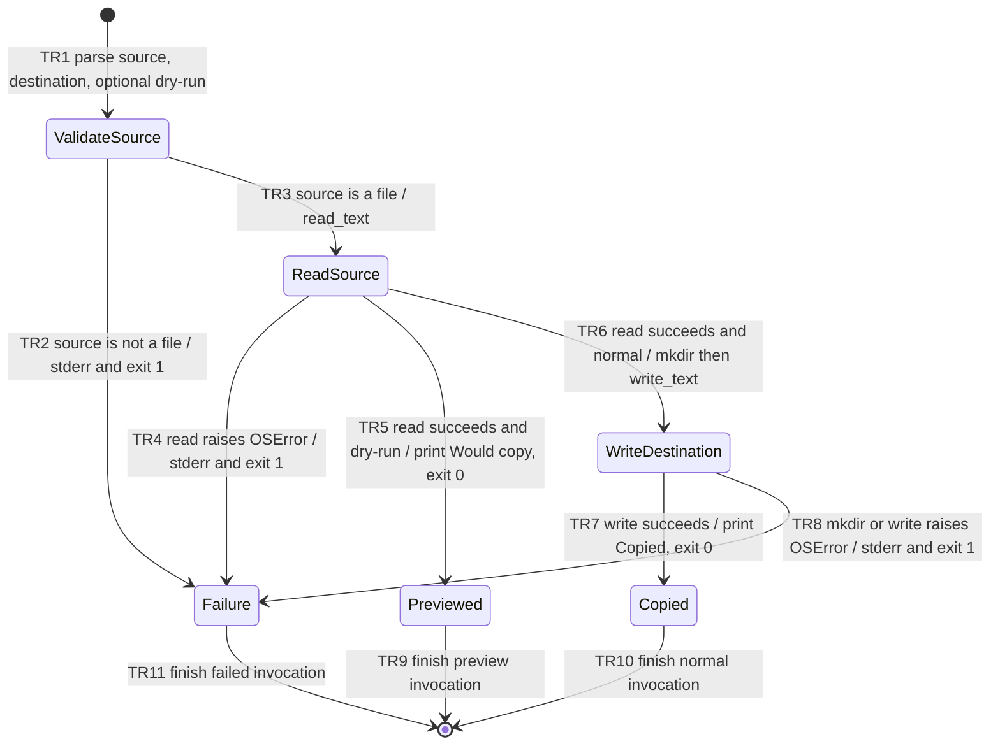

# FEATURE: COPY_TEXT_DRY_RUN

Status: DRAFT
Project root: /tmp/dawg-plan-sol-eval
Plan revision: draft 1 (2026-11-11)

This evaluation uses the copied, unmodified fixture project at
`/tmp/dawg-plan-sol-eval/`. The plan is saved at the normal skill-prescribed
`.dawgy/dwag-plan/FEATURE_COPY_DRY_RUN/PLAN.md` with its sibling
`verifications/verification.md`. The original shared fixture remains read-only.

## Intent and scope

- User outcome: preview a text copy without changing the destination filesystem.
- Current behavior: `copy_text.py` parses two Path arguments, rejects a non-file
  source with `Source must be a file` on stderr and exit 1, reads the source,
  creates destination parent directories, writes/overwrites destination content,
  and prints `Copied SOURCE -> DESTINATION` with exit 0. Its OSError handler
  prints the exception to stderr and returns 1.
- Desired behavior: `--dry-run` keeps the existing source validation and read;
  after a successful read, print `Would copy SOURCE -> DESTINATION` and return 0
  before directory creation or destination writing.
- Confirmed constraints: standard library only; no destination writability check
  needed for dry run; normal copy output and overwrite behavior preserved;
  planning only, no implementation authorization.
- Exclusions: new overwrite policy, destination writability checks for dry run,
  changes to encoding or exception handling, atomic copying, new dependencies.
- Assumptions: use argparse's normal boolean flag behavior; preserve Path's
  existing string formatting in output. These follow the existing CLI style.
- Open product questions: none; request is concrete. Readiness blocker: both
  required design reviews are pending, deliberately not recursively performed
  during this evaluation.

## Acceptance criteria

| ID | Observable success condition | Verification IDs |
| --- | --- | --- |
| AC1 | Valid `--dry-run` reads the source, prints exactly `Would copy SOURCE -> DESTINATION` plus newline, and exits 0. | V1, V2 |
| AC2 | Dry run creates no directory or file and leaves an existing destination unchanged. | V1 |
| AC3 | Missing/non-file source and source-read OSError have the same stderr and exit-1 behavior in both modes, without destination writes. | V2 |
| AC4 | Normal copy still creates missing parents, writes source text, overwrites an existing destination, and prints `Copied SOURCE -> DESTINATION` with exit 0. | V1 |
| AC5 | Change uses only the current standard-library setup. | V3 |

## State machine

Recovery after failure is a new CLI invocation after the input or filesystem
problem is corrected. No persistent application state is introduced.

| Transition | From → to | Trigger / guard / effect | Verification IDs |
| --- | --- | --- | --- |
| TR1 | Start → ValidateSource | Existing positional arguments with optional boolean flag | V1, V2 |
| TR2 | ValidateSource → Failure | Missing or non-file source; existing error behavior | V2 |
| TR3 | ValidateSource → ReadSource | File source; attempt read before choosing output mode | V1, V2 |
| TR4 | ReadSource → Failure | OSError during read; existing error behavior | V2 |
| TR5 | ReadSource → Previewed | Successful read and flag; print preview and exit before writes | V1, V2 |
| TR6 | ReadSource → WriteDestination | Successful read without flag; existing mkdir/write | V1, V2 |
| TR7 | WriteDestination → Copied | Successful normal write; existing output | V1 |
| TR8 | WriteDestination → Failure | Destination OSError; existing error behavior | V2 |
| TR9 | Previewed → End | Exit preview invocation | V1 |
| TR10 | Copied → End | Exit normal invocation | V1 |
| TR11 | Failure → End | Exit failed invocation | V2 |

Invariants:

- I1: Dry run never calls destination mkdir/write; checked by filesystem snapshots
  (V1) and mocks (V2).
- I2: Both modes perform the same source validation/read before success; checked
  by missing/directory source cases and injected read failure (V2).
- I3: Normal copying retains its destination effects and diagnostics (V1, V2).
- I4: No third-party dependency or test framework is introduced (V3).

## Implementation tasks

### T1: Add the dry-run branch while preserving normal copying

- Deliverable and code location: in `copy_text.py`, add argparse's `--dry-run`
  store-true option. Retain source is_file validation. Inside the current try
  block, read the source, then return the preview result when the flag is set,
  before the existing mkdir/write calls. Preserve normal success output and the
  shared OSError handler.
- Dependencies: none after plan readiness and implementation authorization.
- Covers: AC1–AC5; TR1–TR11; I1–I4.
- Verification: V1 functional subprocess checks; V2 source/error and effect-order
  checks; V3 focused diff inspection. Exact commands/procedure are in the ledger.
- Expected result: all assertions pass, only the intended CLI/read-branch change
  appears, and no new dependencies exist.
- Evidence: planned `verifications/v1-functional.log`,
  `verifications/v2-errors.log`, and `verifications/v3-diff-review.txt`.

This is a single small behavioral change; splitting flag parsing from its
semantics would create an incomplete intermediate feature. No permanent test
framework or extensive new test suite is needed.

## Independent design reviews

| Reviewer | Model / effort | Plan revision reviewed | Findings and disposition | Record |
| --- | --- | --- | --- | --- |
| Astra | gpt-6-astra / high | Pending | Pending; nested review intentionally deferred by evaluation instruction | Planned verifications/design-review-astra.md |
| Sol | gpt-6.1-sol / high | Pending | Pending; nested review intentionally deferred by evaluation instruction | Planned verifications/design-review-sol.md |

Readiness: not ready. Both independent reviews must complete for this revision
and all material findings must be resolved. No review is represented as complete.
If an exact model, effort, or delegation tool is unavailable, record the blocker
and keep this draft unready without substitution.

## Verification and handoff

Checklist: [verifications/verification.md](verifications/verification.md)

- Implementation authorization: planning only. No fixture code was changed.
- Completion rule: all required checks pass with evidence; both reviews cover
  final design. Design review does not prove implementation.
- Current result: draft 1 written for evaluation; implementation and checks NOT
  RUN; both nested reviews pending. No screenshot evidence is applicable to this
  CLI feature. If screenshots are later captured, save them under verifications
  and display each in chat with an absolute-path Markdown embed.

## Separate ambiguity probe

For only “make copy safer”, keep a draft BLOCKED and ask focused questions before
choosing behavior:

1. What failure or unwanted result are you trying to prevent—for example,
   overwriting an existing file, copying the wrong source, or losing a file
   during an interrupted write? Please give a concrete example.
2. In that situation, what should the command do and report: refuse, ask before
   proceeding, or provide a preview? Should current callers keep their behavior
   unless an option is supplied?

The examples are choices to clarify intent, not requirements. Investigate the
current CLI and relevant project instructions while awaiting answers; ask
follow-ups only for remaining material gaps. Do not assume the answer is dry run.
