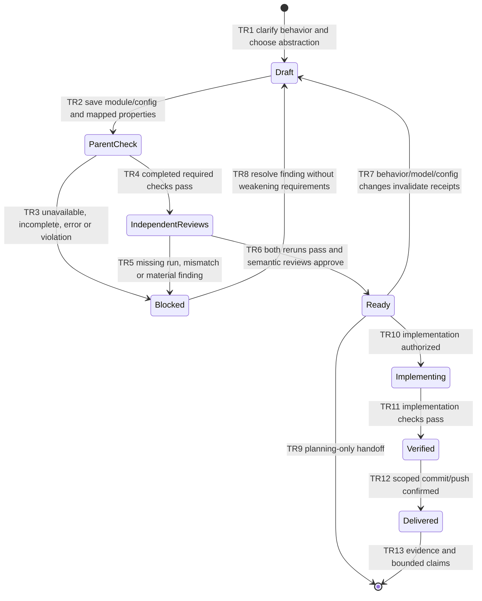

# FEATURE: Required TLA+ verification and independent reviewer execution

Status: VERIFIED
Plan revision: 1 — 2026-11-12
Source repository: /home/chy/Documents/ChatGPT/skill-related/pdawgy-skills
Selected target-relative path: .
Worktree / mapped project: /home/chy/Documents/ChatGPT/skill-related/pdawgy-skills-worktrees/dawg-plan-tla-verification
Base: f658f2586febbeabbc48101b5c69d081c781e78d (merged PR #1)
Task branch: codex/feature/dawg-plan-tla-verification
Remote: origin / same task branch
Implementation authorized: user requested dawg-plan and both subagents use TLA+.
Delivery: PENDING; final commit/push receipt in chat.

## Intent and scope

Every feature/fix plan must include a meaningful TLA+ specification and executable
TLC configuration, not merely a diagram or a claim of formal review. Model the
actual requested behavior at the smallest useful abstraction. Keep Mermaid
state machines for human inspection and map acceptance criteria/transitions to
TLA actions, safety invariants and applicable temporal properties. Explicitly
identify assumptions, finite bounds, fairness/deadlock choices, omitted behavior,
and what still needs implementation testing. Do not describe bounded model
checking as a proof of arbitrary code or all parameter sizes.

Before plan readiness, the parent runs the configured finite model to completion
with all required properties enabled and saves reproducible evidence. Both exact
reviewers (gpt-6-astra/high and gpt-6.1-sol/high) independently inspect model/config,
requirement mapping, meaningful reachability, and results; each independently
reruns TLC in its own state/log directory and records tool/model/config/dependency
identity plus results. A reviewer may use the same audited runner, but must read
raw outputs/config and not trust the parent's receipt. Missing tools, timeout,
incomplete exploration, counterexample, or missing reviewer execution blocks
readiness. Expected negative probes are explicitly separate from production
checks; never count a syntax/runtime error as a successful counterexample.

Material changes to behavior, spec/config, constants/bounds/properties, assumptions,
or fairness invalidate the parent and both reviewer receipts; rerun and rereview
against the same final content identity. Implementation tests remain required and
proportionate. Existing worktree, scoped Git commit/push, cleanup boundaries and
planning-only limits stay intact.

Add a required linked references/tla-verification.md guide, update dawg-plan
entrypoint/review instructions/PLAN and verification templates/UI, align dawg-init
and its coding-guide asset, root AGENTS/README/ARCHITECTURE, and version to 0.4.0.
Do not bundle a JAR or add a framework/runtime helper merely for this policy.
Current plan's small runner/model live only as preserved verification artifacts.

## Acceptance criteria

| ID | Observable result | Check |
| --- | --- | --- |
| AC1 | Every plan requires a concrete TLA module/config, meaningful properties and requirement/diagram mapping, with bounded-scope limitations | V1, V2 |
| AC2 | Parent and both exact reviewers independently run completed TLC checks on identical final model/config inputs before readiness | V1, V2 |
| AC3 | Unavailable/incomplete/error/counterexample/stale results block readiness; expected negative probes are separate and nonvacuity checked | V1, V2 |
| AC4 | Existing intent/diagram/task/evidence/worktree/delivery requirements and caller compatibility remain; metadata/templates/docs consistent | V2 |
| AC5 | Skill/schema/link checks pass, task-only Conventional Commit/push confirmed | V2, V3 |

## State machine

TR1–TR8 map to PlanGate Init/CheckParent/CheckReviewer/Approve/MarkReady/Revise;
TR9–TR13 map to ImplementAuthorized/Implement/Verify/Commit/Push. Failure/blocked
TLC runs map to fail/blocked result values while remaining draft (diagram expands
that user-visible blocker). Git isolation and real tool execution are inspected
contracts, not proven by an abstract receipt variable.

## TLA+ model and checked properties

Model: verifications/tla/PlanGate.tla. Two named reviewers and at most one material
revision (revision values 0 and 1). Results are pending/pass/fail/blocked;
implementation authorization is checked both true and false. Parent/reviewer
receipt revisions and semantic approvals gate readiness; revising clears them.
The model abstracts tool execution as reported results and does not prove an
agent/tool truthful, filesystem operations, Git mechanics or source refinement.

Properties: TypeOK; ReadinessSound (current successful parent and both reviewer
runs plus approvals for any ready-or-later state); DeliverySound (verified and
authorized implementation before commit/delivery); PlanningOnlySafe.
No liveness/progress guarantee is claimed: external decisions or tools may remain
blocked indefinitely. CHECK_DEADLOCK is enabled; Hold models intentional ready
handoff and delivered terminal states, not arbitrary suppression of failures.

| Configuration | Expected outcome | Purpose |
| --- | --- | --- |
| PlanGate.cfg | completed, exit 0, all safety properties hold | implementation-authorized bounded model |
| PlanOnly.cfg | completed, exit 0, all safety properties hold | planning-only cannot implement/deliver |
| MissingReview.cfg | ReadinessSound violation with trace | deliberately remove reviewer gate to detect missing independent checks |
| ReachReady.cfg | NoReadyReached violation with trace | valid readiness reachable; safety result is not due to an impossible ready state |

The bug-switch constant EnforceReviewChecks is TRUE in production configs and
FALSE only in the labeled negative probe; it is not an optional workflow setting.
Acceptance mapping: AC1–AC3 / TR2–TR8 -> ReadinessSound and both sensitivity/witness
checks; AC4's planning/delivery boundary -> PlanningOnlySafe/DeliverySound.
Other AC4/AC5 requirements are source inspection and implementation/Git checks.

Primary attempt 1 parsed successfully but was BLOCKED by sandbox denial of TLC's
local monitoring socket (exit 255), not a model counterexample. Attempt 2 ran with
authorized local execution: PlanGate 210 distinct states; PlanOnly 202; both queues
empty and exit 0. The two labeled probes produced the expected named violations
and traces (exit 12). All raw logs/receipts are preserved. Default Java shim was
unconfigured; explicit installed Java binary was used without global config edits.

## Small tasks

### T1: Formal verification contract and templates

Deliver required TLA guide, main skill/readiness/reviewer workflow, artifact
paths, and mapping/result fields in templates/UI. Dependencies: reviewed plan
ready. AC1–AC3. V1 executes real bounded TLC models/probes with all three agents;
V2 inspects source/metadata. Evidence: tla/runs/, reviewer records, validation.log.

### T2: Align callers and repository documentation

Update dawg-init and its AGENTS asset, root coding guide, README/architecture and
plugin version. Keep architecture sync focused and all prior Git rules intact.
AC4/AC5. Verify V2 source trace, links and standard validators. No old evidence
changes. Evidence: validation.log and both authored-source reviews.

### T3: Verify and deliver

After V1/V2 pass, inspect full task-only index and created tree, commit
`feat(dawg-plan): require TLA+ verification and reviewer reruns`, push current task
branch normally and confirm remote OID. AC5; V3. Keep committed verification as a
pre-delivery snapshot and final delivery receipt in chat. No implicit main merge.

## Independent reviews

| Reviewer | Model/effort | Revision | Outcome | Record |
| --- | --- | --- | --- | --- |
| Astra | gpt-6-astra/high | 1; authored source | independent TLC and final source approved, no material findings | verifications/design-review-astra.md |
| Sol | gpt-6.1-sol/high | 1; authored source | independent TLC and final source approved, no material findings | verifications/design-review-sol.md |

Readiness needs parent and both reviewer TLC outcomes plus semantic approval on
current spec/config. Checklist: [verifications/verification.md](verifications/verification.md).

Both reviewers independently executed/audited all four configs with matching
model/config/tool identity: positive runs 210/202 distinct states and empty queues;
named negative/witness traces exit 12. Both approved revision 1 with no material
findings. Each preserved its initial sandbox-blocked attempt and successful fresh
attempt. Both also approved final authored source, confirming current formal inputs
and copied evidence identical to their independently executed inputs. No rerun was
needed because the reviewed formal contract did not change. V1/V2 pass; standard
validators, metadata/links/JSON/whitespace and source-scope checks pass. Old evidence
is untouched. Delivery remains pending until the scoped Conventional Commit/push;
the final receipt will be in chat, leaving this an honest pre-delivery snapshot.
