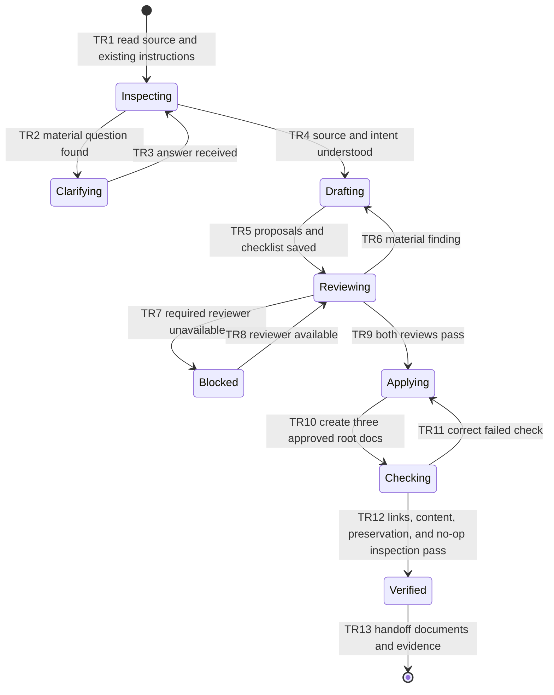

# FEATURE: Initialize Pdawgy Skills repository guidance

Status: VERIFIED
Project root: /home/chy/Documents/ChatGPT/skill-related/pdawgy-skills
Plan revision: 1 — 2026-11-12

## Intent and scope

Run the installed dawg-init and dawg-architecture-maintain workflows on this
repository. Create root AGENTS.md, CLAUDE.md, and ARCHITECTURE.md from the
source-grounded proposals under `proposals/`. This initialization is authorized.
There are no root or ancestor instruction files on disk to merge; the user's
session standards and the existing skills/README supply the coding conventions.

The current repository is a Markdown/JSON/YAML skills plugin, not the sample
Python application preserved in archived evaluations. Git is on main with no
commits or remote; every existing file is untracked. Preserve all existing bytes.
Do not alter packaged skills, version, installed cache, historical evidence, or
README just to initialize root guidance. No app test/build/lint runner exists.

No material intent questions remain. Existing document templates and archived
fixture copies are intentional reusable inputs/evidence, not demonstrated waste.
No justified cleanup candidate was found; no cleanup is proposed or authorized.
If one emerges, present its exact edits and seek bounded approval before removal.

## Acceptance criteria

| ID | Observable success condition | Verification |
| --- | --- | --- |
| AC1 | Root AGENTS contains repository-specific coding/verification rules and Dawg standards, with architecture prose separated | V1 |
| AC2 | Root CLAUDE delegates to AGENTS without inventing additional rules | V1 |
| AC3 | ARCHITECTURE describes actual catalog/manifest/skill composition, target-project artifacts, and external authoring dependencies | V1 |
| AC4 | All existing files remain byte-identical; only three root docs plus this plan/evidence are added; no cleanup occurs | V2 |
| AC5 | Required dual reviews complete; document/resource links and documented local checks work; reread finds no further guidance/architecture change necessary | V1, V2 |

## State machine

| Transitions | Verification |
| --- | --- |
| TR1–TR9 | V1 source/intent and exact reviewer records; blocked/error branches are reviewed, not artificially exercised |
| TR10–TR13 | V1 document checks and V2 preservation/no-op inspection |

Invariants: preserve all existing bytes; keep AGENTS about coding and ARCHITECTURE
about implemented design; do not claim unexecuted checks; no cleanup without
specific approval; no plan readiness without both required reviewers (V1/V2).

## Small tasks

### T1: Establish the shared coding guide and CLAUDE delegation

- Deliverable: root AGENTS.md and CLAUDE.md, copied from reviewed proposals.
- Dependencies: reviewed plan ready.
- Covers: AC1, AC2, AC5; TR1–TR11.
- Verification: V1 checks content, relative links, JSON commands and skill-validator
  command with actual installed prerequisites; no new tests/framework required.
- Evidence: verifications/design-review-{astra,sol}.md and document-checks.log.

### T2: Document the implemented architecture and verify preservation

- Deliverable: root ARCHITECTURE.md and completed ledger.
- Dependencies: reviewed plan ready; consistent root guidance links from T1.
- Covers: AC3–AC5; TR10–TR13 and invariants.
- Verification: V1 traces claims to manifests/skills; V2 compares before.json
  hashes and allowed additions, then rereads all docs/source to confirm no-op.
- Evidence: document-checks.log, preservation.json, verification.md.

## Independent design reviews

| Reviewer | Model / effort | Revision | Outcome | Record |
| --- | --- | --- | --- | --- |
| Astra | gpt-6-astra / high | 1 | No material findings; approved | verifications/design-review-astra.md |
| Sol | gpt-6.1-sol / high | 1 | No material findings; approved | verifications/design-review-sol.md |

The proposed exact document contents are in proposals/. Both reviewers receive
the same plan, checklist, proposals and source context. All material findings must
be resolved and reviewed before creating the root files.

Both read-only reviewers approved revision 1, checked intended-root links and
validator prerequisites, and independently confirmed all 125 original files
unchanged with root guidance still absent. No material questions or findings
remain. Implementation is ready and already authorized by the user.

## Handoff

Checklist: [verifications/verification.md](verifications/verification.md).
Plan completion requires both V1/V2 checks passed with evidence. No screenshot
is relevant to these text documents. Cleanup status: none identified; none applied.

Completed: reviewed proposals copied exactly to the three root files; documented
JSON/skill-validation/whitespace commands pass; all 12 relative document links
resolve; both reviewers inspected the actual documents and confirmed an accurate
no-op. All 125 original files retain identical bytes. Only AGENTS.md, CLAUDE.md,
and ARCHITECTURE.md were added outside this plan. No package/cache/version change,
staging, or cleanup was performed. V1 and V2 pass with saved evidence.
