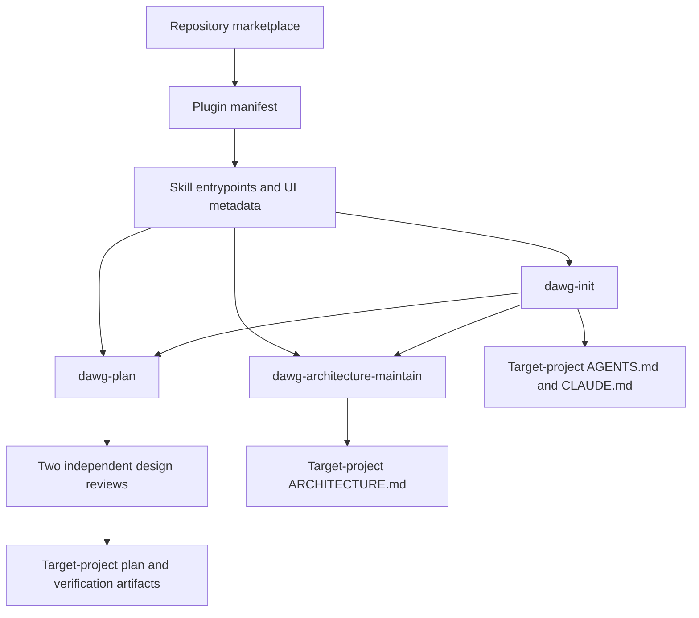

# Pdawgy Skills architecture

## Purpose and scope

Pdawgy Skills is a skills-only Codex plugin distributed through a repository
marketplace. The current package contains three instruction-driven workflows.
There is no application service, bundled MCP server, lifecycle hook, or declared
project build/test framework in the current source package.

## Package boundaries

- [.agents/plugins/marketplace.json](.agents/plugins/marketplace.json) defines the
  `pdawgy-skills` marketplace and one local plugin entry. Its source path,
  `./plugins/pdawgy-skills`, resolves from the repository root. Installation is
  available to the user; the catalog declares an on-install authentication
  policy, while the package itself contains no connected service.
- [plugins/pdawgy-skills/.codex-plugin/plugin.json](plugins/pdawgy-skills/.codex-plugin/plugin.json)
  is the Codex compatibility manifest. It owns the plugin identity, version,
  listing metadata, and `./skills/` discovery path relative to the plugin root.
- Each directory beneath `plugins/pdawgy-skills/skills/` contains a `SKILL.md`
  entrypoint and `agents/openai.yaml` UI metadata. Supporting assets belong to
  the skill that uses them; no bundled executable scripts are required by the
  current skills.
- [README.md](README.md) describes the package and installation entry points.
  [AGENTS.md](AGENTS.md) defines repository development rules; [CLAUDE.md](CLAUDE.md)
  delegates to that coding guide.

## Workflow composition

[dawg-plan](plugins/pdawgy-skills/skills/dawg-plan/SKILL.md) investigates a feature
or fix, resolves material ambiguity, models its state transitions, and defines
small verifiable tasks. Its assets provide plan and verification templates.
Every plan requires independent `gpt-6-astra` and `gpt-6.1-sol` design reviews at
high effort; unavailable reviews block readiness. Design readiness and verified
implementation are separate states.

[dawg-init](plugins/pdawgy-skills/skills/dawg-init/SKILL.md) inspects an existing
project or new directory and runs dawg-plan before guidance writes. It establishes
coding instructions and compatible CLAUDE delegation, and delegates architecture
work to dawg-architecture-maintain. Its assets contain reusable starting points
for the three documents. Cleanup is identified during inspection and applied
only after approval of concrete changes.

[dawg-architecture-maintain](plugins/pdawgy-skills/skills/dawg-architecture-maintain/SKILL.md)
creates or synchronizes architecture documentation against source. Routine
synchronization reuses a calling task's context and evidence without recursively
invoking init or restarting its plan. Proposed feature/refactor work routes to
dawg-plan. Accurate documents remain byte-identical on a no-op run.

## Artifacts and execution context

The calling coding agent executes these workflows with its available file,
shell, and subagent tools. The plugin supplies instructions and templates rather
than a separate execution service. Its reviewer requirement depends on both exact
models and high-effort delegation being available. Skill validation uses an
external installed skill-creator validator with Python/PyYAML; that authoring
tool is not a bundled runtime dependency.

Plans are written in the project being worked on at
`.dawgy/dwag-plan/<FIX|FEATURE>_<PLAN_NAME>/`. Each has `PLAN.md` and a
`verifications/` directory containing `verification.md`, reviews, and applicable
logs/screenshots. The `dwag-plan` spelling is intentional. This repository's own
`.dawgy/` tree preserves development plans, snapshot validation helpers, and
controlled evaluation projects. Those Python fixtures and copied guidance are
historical test inputs and evidence, not additional plugin components.

Repository sources and an installed plugin cache are separate copies. The local
installation used during development was verified against the source package;
later source edits need an explicit plugin refresh to reach the installed copy.
Installation records are historical evidence, not a guarantee of current account
state.

Architecture maintenance occurs during relevant coding tasks through the shared
AGENTS workflow. The current package contains no unattended maintenance process.
