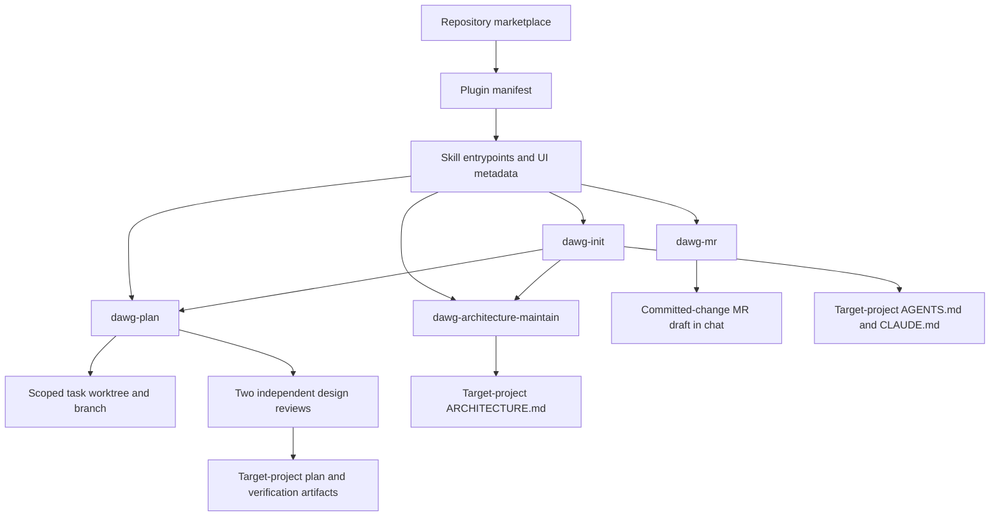

# Pdawgy Skills architecture

## Purpose and scope

Pdawgy Skills is a skills-only Codex plugin distributed through a repository
marketplace. The current package contains four instruction-driven workflows.
There is no application service, bundled MCP server, lifecycle hook, or declared
project build/test framework in the current source package.

## Package boundaries

- [.agents/plugins/marketplace.json](.agents/plugins/marketplace.json) defines the
  `pdawgy-skills` marketplace and one local plugin entry. Its source path,
  `./plugins/pdawgy-skills`, resolves from the repository root. Installation is
  available to the user; the catalog declares an on-install authentication
  policy, while the package itself contains no connected service.
- [plugins/pdawgy-skills/.codex-plugin/plugin.json](plugins/pdawgy-skills/.codex-plugin/plugin.json)
  is the Codex compatibility manifest. It owns the plugin identity, version,
  listing metadata, and `./skills/` discovery path relative to the plugin root.
- Each directory beneath `plugins/pdawgy-skills/skills/` contains a `SKILL.md`
  entrypoint and `agents/openai.yaml` UI metadata. Supporting assets belong to
  the skill that uses them; no bundled executable scripts are required by the
  current skills.
- [README.md](README.md) describes the package and installation entry points.
  [AGENTS.md](AGENTS.md) defines repository development rules; [CLAUDE.md](CLAUDE.md)
  delegates to that coding guide.

## Workflow composition

[dawg-plan](plugins/pdawgy-skills/skills/dawg-plan/SKILL.md) investigates a feature
or fix, resolves material ambiguity, models its state transitions, and defines
small verifiable tasks. Its assets provide plan and verification templates.
Every plan requires a concrete TLA+ model/configuration and parent TLC run, followed
by independent TLC execution and semantic review from `gpt-6-astra` and
`gpt-6.1-sol` at high effort. The required
[TLA+ guide](plugins/pdawgy-skills/skills/dawg-plan/references/tla-verification.md)
defines domain/requirement mapping, enabled properties and assumptions, finite
bounds, actual completion evidence, reachability checks, and shared final input
identities. Missing, failed, incomplete or stale executions block readiness.
Material formal-input or requirement changes invalidate all three receipts.
Bounded model checking and implementation verification remain separate checks.

The required [recovery loop](plugins/pdawgy-skills/skills/dawg-plan/references/recovery-loop.md)
turns observed non-green results into persistent, check-linked issues. The
failure-register asset supplies `verifications/failures.md`; immutable attempts
record diagnosis, correction, current input identity and rerun evidence. Agents
repair and recheck until each phase's required results are green with no unresolved
issues, reopen regressions and preserve historical failures. Genuine external
dependencies stay explicitly blocked while independent work continues. Planned
later phases and exact expected negative probes are kept separate from actual
unresolved product failures.

The required [Git workflow](plugins/pdawgy-skills/skills/dawg-plan/references/git-workflow.md)
gates every feature/fix on Git initialization consent and a committed base, then
creates or resumes a dedicated task worktree. It records original repository and
selected relative scope, mapping the project into that worktree. Plans, evidence,
implementation and caller changes stay in the mapped target. After authorized
implementation passes checks, it audits the entire index and commit delta,
creates a Conventional Commit, and normally pushes the task feature/fix branch
with remote OID confirmation. Unrelated staging, failed checks and delivery errors
remain explicit blockers. Planning-only requests stop before implementation and
delivery; final delivery receipts are reported in chat rather than requiring a
self-referential tracked receipt.

[dawg-init](plugins/pdawgy-skills/skills/dawg-init/SKILL.md) inspects an existing
project or new directory and runs dawg-plan before guidance writes. It establishes
coding instructions and compatible CLAUDE delegation, and delegates architecture
work to dawg-architecture-maintain. Its assets contain reusable starting points
for the three documents. Cleanup is identified during inspection and applied
only after approval of concrete changes. It adopts dawg-plan's mapped worktree
project, preserves selected subdirectory scope, and delegates verified delivery
back to that same workflow. A new directory requires Git initialization consent
before its planning/guidance phase. After planning, initialization ensures the
mapped project's `.dawgy/` is effectively ignored, creating/updating its scoped
`.gitignore` only as needed. Existing rules and tracked artifacts are preserved;
conflicting inclusion rules need user input. Effective Git checks and byte-stable
reruns verify this step. New ignored plans/evidence remain local during delivery.

[dawg-architecture-maintain](plugins/pdawgy-skills/skills/dawg-architecture-maintain/SKILL.md)
creates or synchronizes architecture documentation against source. Routine
synchronization reuses a calling task's context and evidence without recursively
invoking init or restarting its plan. Proposed feature/refactor work routes to
dawg-plan. Accurate documents remain byte-identical on a no-op run.

[dawg-mr](plugins/pdawgy-skills/skills/dawg-mr/SKILL.md) is a read-only drafting
workflow. It pins a committed comparison range, inspects changed behavior and
relevant consumers, and classifies verification evidence by revision and source.
Its MR/PR message covers problem, fix, blast radius and verified/tested outcomes,
including failures or missing evidence. Drafting does not invoke dawg-plan,
launch tests, alter Git state or publish an MR. It adds no scripts or services.

## Artifacts and execution context

The calling coding agent executes these workflows with its available file,
shell, and subagent tools. The plugin supplies instructions and templates rather
than a separate execution service. Its reviewer requirement depends on both exact
models and high-effort delegation being available. Skill validation uses an
external installed skill-creator validator with Python/PyYAML. Formal planning
also needs external Java/TLC tooling. Those tools are used by the calling agents;
neither their binaries nor a separate model-checking service are bundled here.

Plans are written in the mapped project inside the task worktree at
`.dawgy/dwag-plan/<FIX|FEATURE>_<PLAN_NAME>/`. Each has `PLAN.md` and a
`verifications/` directory containing `verification.md`, reviews, and applicable
logs/screenshots. `failures.md` is the durable issue/attempt register, linked to
the checklist. Its `tla/` subtree holds specifications/configs, tool/input
identities, parent/reviewer runs and relevant counterexamples. Reviewers use their
own fresh metadata/log locations and preserve evidence without editing the model.
The `dwag-plan` spelling is intentional. This repository's own
`.dawgy/` tree preserves development plans, snapshot validation helpers, and
controlled evaluation projects. Those Python fixtures and copied guidance are
historical test inputs and evidence, not additional plugin components. Repository
`.gitignore` excludes new `.dawgy/` artifacts; previously tracked history remains
tracked.

Repository sources and an installed plugin cache are separate copies. The local
installation used during development was verified against the source package;
later source edits need an explicit plugin refresh to reach the installed copy.
Installation records are historical evidence, not a guarantee of current account
state.

Architecture maintenance occurs during relevant coding tasks through the shared
AGENTS workflow. The current package contains no unattended maintenance process.
