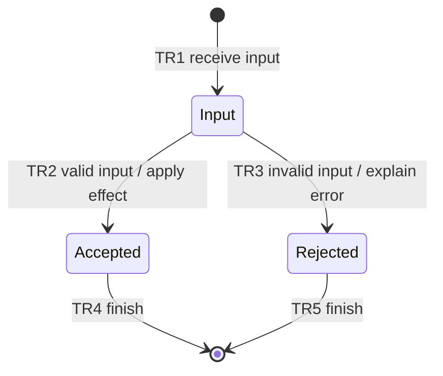

# <FIX|FEATURE>: <Plan name>

Status: DRAFT | BLOCKED | READY | IMPLEMENTING | VERIFIED
Project root: <mapped project path inside task worktree>
Plan revision: <revision/date; update after material changes>
Review tier and rationale: <small or large; impact/complexity/risk, not file count>
Required reviewers: <Sol/high; add Astra/high for large; record escalation>
Source repository root: <original checkout>
Selected target-relative path: <scope inside repository, or .>
Worktree repository root: <linked task worktree>
Base commit and task branch: <revision; codex/feature/... or codex/fix/...>
Remote and task destination branch: <chosen remote; same task branch name>
Delivery snapshot: PLANNING ONLY | PENDING | COMMITTED | PUSHED | BLOCKED
Final delivery receipt: <chat handoff; not a self-referential tracked receipt>

## Intent and scope

- User outcome and confirmed decisions: <concrete goal>
- Current behavior: <observed baseline; reproduction for a fix>
- Desired behavior: <observable change>
- Scope, constraints, and exclusions: <boundaries>
- Assumptions: <low-impact choices and their rationale>
- Open questions or blockers: <unresolved material decisions; none when ready>

## Acceptance criteria

| ID | Observable success condition | Verification IDs |
| --- | --- | --- |
| AC1 | <specific result> | V1 |

## State machine

Replace the illustrative states with the feature's actual behavior. Include
relevant failure and recovery transitions. Show the completed diagram in chat.

| Transition | From → to | Trigger / guard / effect | Verification IDs |
| --- | --- | --- | --- |
| TR1 | <states> | <observable behavior> | V1 |

Invariants: <properties that must hold across transitions and how they are checked>

## TLA+ specification and results

- Module/configuration/imported dependencies: <paths under verifications/tla/>
- Current model identity: <revision and content hashes of every effective input>
- Abstraction, finite domains/constants and assumptions: <explicit checked scope>
- Safety and applicable temporal properties: <names; fairness; deadlock settings;
  state explicitly when no liveness property is checked>
- Omissions and implementation correspondence: <what the model excludes and
  concrete checks that still cover those requirements>

| Acceptance / transition IDs | TLA action / property | Configuration / verification |
| --- | --- | --- |
| AC1 / TR1 | <actual behavior, not a generic planning process> | <config; check ID> |

| Agent | Tool/input identity | Actual command and run evidence | Result / states / scope |
| --- | --- | --- | --- |
| Parent | <current hashes/version> | <verifications/tla/runs/...> | <not run or actual> |
| Astra (large only) | <same final inputs if required> | <own run or not required for small> | <actual or not required> |
| Sol | <same final inputs> | <own independent run> | <not run or actual> |

Reachability/sensitivity: <evidence nominal paths are reachable; focused negative
or regression probe when useful; expected violations separate from required runs>.
Any material behavior/model/config/bound/assumption/fairness change invalidates
the parent and all required reviewer receipts and requires new executions plus
semantic review. Scope growth requires the large-tier set before readiness.

## Implementation tasks

### T1: <small deliverable>

- Deliverable and code locations: <specific change>
- Dependencies: <task IDs or none>
- Covers: <acceptance IDs, transition IDs, invariants>
- Verification: <verification IDs; exact command or concrete procedure>
- Expected result: <observable pass condition>
- Evidence: <relative path inside verifications/>
- Failure/recovery links: <F IDs and failed/affected checks; none if not observed>

Repeat for the smallest useful remaining tasks. Keep shared verification under
one ID when it proves multiple tasks or transitions.

## Independent design reviews

| Reviewer | Model / effort | Plan revision reviewed | Findings and disposition | Record |
| --- | --- | --- | --- | --- |
| Astra (large only) | gpt-6-astra / high | <revision if required> | <actual outcome or not required for small> | <verifications/design-review-astra.md when required> |
| Sol | gpt-6.1-sol / high | <revision> | <pending or actual outcome> | verifications/design-review-sol.md |

Readiness: <parent and every tier-required reviewer independently completed TLC
on current inputs; all required semantic reviews approved; findings resolved;
Astra explicitly not required for small work, no fabricated run>

## Verification and handoff

Checklist: [verifications/verification.md](verifications/verification.md)
Failure register: [verifications/failures.md](verifications/failures.md)

- Implementation authorization: <planning only, or existing user authorization>
- Completion rule: all required checks passed with evidence; all tier-required design reviews
  and TLA+ runs cover the final design/inputs. Bounded model checking does not
  replace implementation tests. Authorized implementation also requires a scoped
  Conventional Commit and confirmed task-branch push unless the user limits
  delivery. Design approval alone does not prove implementation or delivery.
- Current result: <plan readiness, execution status, outstanding limitations>
- Green checkpoint: <phase; required passes on current inputs; unresolved F IDs;
  diagnose/repair/rerun until issue exit criteria pass; retain failed history>
- Delivery checks: <entire index/staged scope, complete created commit delta,
  tested source match, remote/task branch, required CI, and blockers>
- Keep committed evidence as a pre-delivery snapshot; report the final commit/OID
  receipt in chat without modifying the verified source or chasing its own hash.
