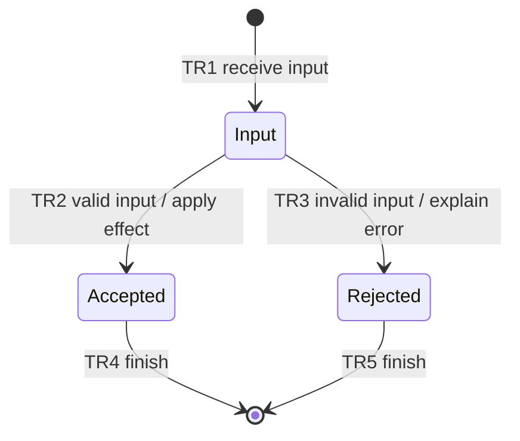

# <FIX|FEATURE>: <Plan name>

Status: DRAFT | BLOCKED | READY | IMPLEMENTING | VERIFIED
Project root: <mapped project path inside task worktree>
Plan revision: <revision/date; update after material changes>
Source repository root: <original checkout>
Selected target-relative path: <scope inside repository, or .>
Worktree repository root: <linked task worktree>
Base commit and task branch: <revision; codex/feature/... or codex/fix/...>
Remote and task destination branch: <chosen remote; same task branch name>
Delivery snapshot: PLANNING ONLY | PENDING | COMMITTED | PUSHED | BLOCKED
Final delivery receipt: <chat handoff; not a self-referential tracked receipt>

## Intent and scope

- User outcome and confirmed decisions: <concrete goal>
- Current behavior: <observed baseline; reproduction for a fix>
- Desired behavior: <observable change>
- Scope, constraints, and exclusions: <boundaries>
- Assumptions: <low-impact choices and their rationale>
- Open questions or blockers: <unresolved material decisions; none when ready>

## Acceptance criteria

| ID | Observable success condition | Verification IDs |
| --- | --- | --- |
| AC1 | <specific result> | V1 |

## State machine

Replace the illustrative states with the feature's actual behavior. Include
relevant failure and recovery transitions. Show the completed diagram in chat.

| Transition | From → to | Trigger / guard / effect | Verification IDs |
| --- | --- | --- | --- |
| TR1 | <states> | <observable behavior> | V1 |

Invariants: <properties that must hold across transitions and how they are checked>

## Implementation tasks

### T1: <small deliverable>

- Deliverable and code locations: <specific change>
- Dependencies: <task IDs or none>
- Covers: <acceptance IDs, transition IDs, invariants>
- Verification: <verification IDs; exact command or concrete procedure>
- Expected result: <observable pass condition>
- Evidence: <relative path inside verifications/>

Repeat for the smallest useful remaining tasks. Keep shared verification under
one ID when it proves multiple tasks or transitions.

## Independent design reviews

| Reviewer | Model / effort | Plan revision reviewed | Findings and disposition | Record |
| --- | --- | --- | --- | --- |
| Astra | gpt-6-astra / high | <revision> | <pending or actual outcome> | verifications/design-review-astra.md |
| Sol | gpt-6.1-sol / high | <revision> | <pending or actual outcome> | verifications/design-review-sol.md |

Readiness: <both completed, material findings resolved, material questions closed>

## Verification and handoff

Checklist: [verifications/verification.md](verifications/verification.md)

- Implementation authorization: <planning only, or existing user authorization>
- Completion rule: all required checks passed with evidence; both design reviews
  cover the final design. Authorized implementation also requires a scoped
  Conventional Commit and confirmed task-branch push unless the user limits
  delivery. Design approval alone does not prove implementation or delivery.
- Current result: <plan readiness, execution status, outstanding limitations>
- Delivery checks: <entire index/staged scope, complete created commit delta,
  tested source match, remote/task branch, required CI, and blockers>
- Keep committed evidence as a pre-delivery snapshot; report the final commit/OID
  receipt in chat without modifying the verified source or chasing its own hash.
